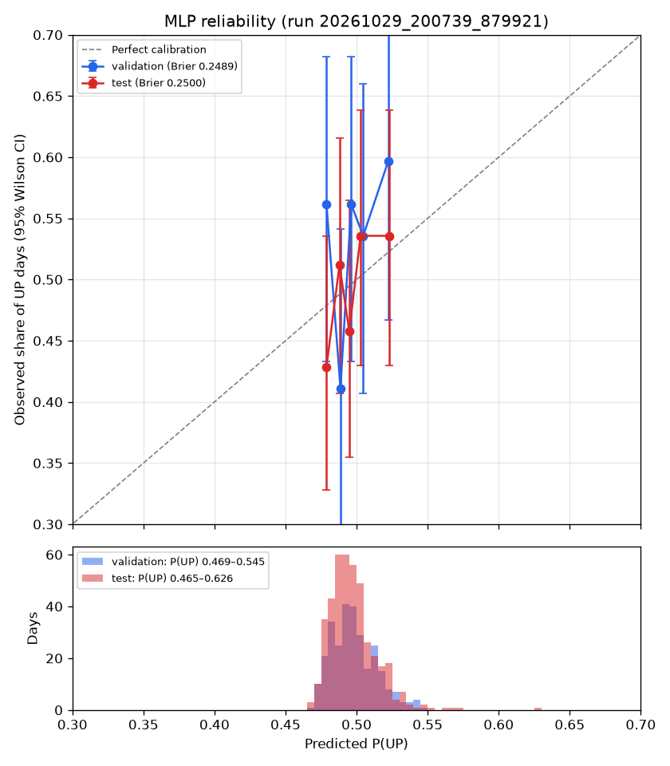

# StockSense: Next-Day Direction Prediction for Reliance Industries

> **Research prototype, not investment advice.** Nothing here is a recommendation to buy or sell any security.

**Live app:** https://stockpredictioncc.streamlit.app · **Stock:** Reliance Industries (`RELIANCE.NS`) · **Context:** NIFTY 50 (`^NSEI`), India VIX (`^INDIAVIX`) · **Models:** PyTorch MLP, LSTM/GRU, scikit-learn and XGBoost baselines

<!-- Generated file: edit docs/README.template.md, then run `python main.py readme`. Every number comes from reports/metrics.json (run 20261029_200739_879921). -->

---

## Conclusion

**Short answer: no reliable, tradeable next-day signal was found.** On 419 held-out trading days (2024-12-23 to 2026-09-10), the MLP's test ROC-AUC is **0.536** (95% block-bootstrap CI 0.481–0.591), which is **not** distinguishable from random guessing, and it is **not** distinguishable from a Random Forest (difference +0.005, CI -0.052 to +0.060).

- **Sequence models** (LSTM/GRU, 10- and 20-day lookback): none beats the MLP.
- **Probabilities:** 98.8% of test predictions lie between 0.45 and 0.55; the Brier score (0.2500) is essentially that of always predicting the base rate (0.2504).
- **Backtest:** After realistic costs and next-open execution, the strategy underperforms buy-and-hold (-17.08% vs -1.43% over the same 419 test periods, 0.15% per side). The strategy made 61 round trips and paid 18.30% of capital in costs.
- **Earlier, better-looking results were artefacts.** The previous version reported test ROC-AUC 0.5676 and a backtest of +23.80% vs +5.13% buy & hold. Fixing the 7 bugs below removed that apparent edge.

> ⚠️ **Backtest result:** After realistic costs and next-open execution, the strategy underperforms buy-and-hold (-17.08% vs -1.43% over the same 419 test periods, 0.15% per side).

## Key Results

| Model | Test ROC-AUC (95% CI) | Test balanced accuracy (95% CI) | ROC-AUC CI excludes 0.5? |
|---|---|---|---|
| MLP | 0.536 (0.481–0.591) | 52.8% (48.7%–56.9%) | No |
| Random Forest | 0.532 (0.475–0.593) | 52.5% (48.0%–57.3%) | No |
| XGBoost | 0.513 (0.466–0.564) | 52.3% (48.1%–56.6%) | No |
| LSTM (10d) | 0.502 (0.457–0.549) | 50.9% (46.8%–55.1%) | No |
| LSTM (20d) | 0.502 (0.455–0.547) | 49.8% (45.7%–54.1%) | No |
| GRU (10d) | 0.533 (0.487–0.579) | 54.5% (50.4%–58.6%) | No |
| GRU (20d) | 0.508 (0.462–0.553) | 49.5% (45.5%–53.5%) | No |
| Logistic Regression | 0.475 (no CI) | 48.3% (no CI) | — |
| Majority class | 0.500 (no CI) | 50.0% (no CI) | — |

**Backtest (next-open, 0.15% per side, 419 days):** strategy -17.08% vs buy & hold -1.43% over the same periods; Sharpe -1.11 vs -0.16 (rf 6.0%, assumption); max drawdown -21.61% vs -19.97%. CIs: stationary block bootstrap, mean block 10 days, 5,000 resamples.

---

## The 7 Bugs Found and Fixed

An end-to-end audit (inspect, fix, re-measure) found these problems. Each one inflated the earlier results, distorted live predictions, or stopped the live app from working.

1. **Live inference** passed market context under the wrong keys, so the six NIFTY/VIX features were never built (live predictions always failed).
2. **Live inference** appended a 1-minute bar to daily data; features now come from completed daily sessions only.
3. **Holiday placeholder bars** (zero volume, no NIFTY/VIX bar) blanked 50-day windows and silently removed 368 sessions from the data.
4. **Targets** were computed on the next *surviving* row, so 19 labels spanned 3–88 sessions instead of one.
5. **Feature selection** compared feature sets on the test period; it now uses validation only.
6. **Backtest** used the next prediction row as 'tomorrow' (same bug as 4), had no next-open execution, and charged no final-exit or buy-and-hold costs.
7. **Reported numbers** in the README/dashboard that no code produced were removed; all numbers now come from `reports/metrics.json`.

How the reported numbers changed:

| | Previous run `20261007_003042` | Current run `20261029_200739_879921` |
|---|---|---|
| Calendar rule | none: holiday placeholder bars kept, leaving ~50-row gaps after each | NIFTY dates define NSE sessions; zero-volume flat placeholder bars dropped |
| Feature matrix rows | 1,890 | 2,230 |
| Split | 70/15/15 by row count | fixed dates: train <= 2023-10-19, val <= 2024-12-20, test <= 2026-09-10 |
| Train / val / test rows | 1,323 / 283 / 284 | 1,513 / 283 / 419 |
| Feature set chosen on | test (F5) | validation (F5) |
| MLP validation ROC-AUC | 0.5390 | 0.5473 |
| MLP validation PR-AUC | 0.5708 | 0.5984 |
| MLP validation Accuracy | 54.77% | 51.94% |
| MLP validation Balanced Accuracy | 54.99% | 52.68% |
| MLP validation Precision | 58.33% | 56.76% |
| MLP validation Recall | 51.33% | 41.72% |
| MLP validation F1 | 0.5461 | 0.4809 |
| MLP test ROC-AUC | 0.5676 | 0.5363 |
| MLP test PR-AUC | 0.5301 | 0.5112 |
| MLP test Accuracy | 57.39% | 52.98% |
| MLP test Balanced Accuracy | 57.39% | 52.82% |
| MLP test Precision | 58.68% | 53.29% |
| MLP test Recall | 50.00% | 39.13% |
| MLP test F1 | 0.5399 | 0.4513 |
| Backtest as originally reported (old engine) | +23.80% vs +5.13% B&H, Sharpe 1.45 (rf 0%) | — |
| Backtest, fixed engine, close-to-close | +18.90% vs +16.37% B&H, Sharpe 0.78, 32 trades, 283 days | -6.49% vs -0.79% B&H, Sharpe -0.73, 61 trades, 419 days |
| Backtest, fixed engine, next-open | +14.83% vs +15.73% B&H, Sharpe 0.57, 32 trades, 283 days | -17.08% vs -1.43% B&H, Sharpe -1.11, 61 trades, 419 days |

---

## Method

### Data
- Daily OHLCV for RELIANCE.NS, NIFTY 50 and India VIX from Yahoo Finance (`yfinance`), October 2016 to October 2026: 2,475 raw Reliance sessions.
- **Trading calendar:** NIFTY dates define NSE sessions; zero-volume flat placeholder bars dropped. This removes holiday placeholder bars (zero volume, no index data) that had silently blanked 50-day windows. A missing India VIX day leaves only that row and the next without VIX features.
- After the 200-day warm-up: **2,230 rows** with 27 features.

### Features (27, all scale-free)
All features at day *t* use data up to and including *t* (`src/features/generator.py`, shared by training and live inference).

| Group | Features | Definition |
|---|---|---|
| F0 Base | `Return_1d`, `Return_5d`, `Return_10d`, `Return_20d` | $C_t / C_{t-k} - 1$ |
| | `HL_Spread`, `CO_Spread` | $(H_t - L_t)/C_t$, $(C_t - O_t)/O_t$ |
| F1 Trend | `Dist_SMA20`, `Dist_SMA50`, `Dist_SMA200` | $C_t / \text{SMA}_k - 1$ |
| | `SMA20_50_Ratio`, `SMA50_200_Ratio` | $\text{SMA}_{20}/\text{SMA}_{50} - 1$, $\text{SMA}_{50}/\text{SMA}_{200} - 1$ |
| F2 Momentum | `RSI_14` | 14-day RSI ÷ 100 (0–1) |
| | `MACD_Ratio`, `MACD_Hist_Ratio` | MACD(12, 26, 9) line and histogram ÷ $C_t$ |
| | `ROC_12` | $C_t / C_{t-12} - 1$ |
| F3 Volatility | `ATR_Ratio` | 14-day ATR ÷ $C_t$ |
| | `Rolling_Vol_20` | 20-day std of daily returns (not annualized) |
| | `BB_PctB`, `BB_Width` | Bollinger(20, 2) %B and band width ÷ middle band |
| F4 Volume | `Vol_Change`, `Vol_Ratio_20` | $V_t/V_{t-1} - 1$, $V_t / \text{SMA}_{20}(V)$ |
| F5 Market context | `NIFTY_Return_1d`, `NIFTY_Return_5d` | NIFTY 1- and 5-day returns |
| | `NIFTY_Vol_20`, `NIFTY_Dist_SMA50` | 20-day std of NIFTY daily returns; NIFTY ÷ its 50-day SMA − 1 |
| | `VIX_Level`, `VIX_Change_1d` | India VIX close ÷ 100; 1-day change |

### Target
$y_t = 1$ if $C_{t+1}/C_t - 1 > 0$, else 0, where $t+1$ is the **next trading session** on the calendar above. It's computed before any rows are filtered, so a gap in the data can never turn "tomorrow" into "weeks later".

### Splits (fixed dates)
| Split | Rows | Dates | UP share |
|---|---|---|---|
| Train | 1,513 | 2017-07-27 → 2023-10-19 | 51.4% |
| Validation | 283 | 2023-10-20 → 2024-12-20 | 53.4% |
| Test | 419 | 2024-12-23 → 2026-09-10 | 49.4% |

Scalers are fitted on training rows only. Everything that involves a choice (feature set, early stopping, no-trade band) uses **validation only**. Each final model was scored on the test set once.

### Models
- **MLP** 1,441 parameters: 27 → 32 → 16 → 1, ReLU, dropout 0.2, Adam (lr 1e-3, weight decay 1e-3), class-weighted BCE, early stopping on validation loss (patience 10). Seed 42.
- **Baselines:** majority class, logistic regression, random forest, XGBoost (same features and splits).
- **Sequence models:** LSTM and GRU with 10- and 20-day windows, configurations fixed in advance.

### Evaluation
- ROC-AUC, PR-AUC, accuracy, balanced accuracy, precision, recall, F1 at threshold 0.5.
- **Uncertainty:** stationary block bootstrap (mean block 10 trading days, because predictions are autocorrelated), paired across models; circular-shift test against chance.
- **Calibration:** reliability diagram, Brier score and log loss against a constant base-rate forecast.

### Backtest
- **Out-of-Sample Test Period:** 419 signal days (2024-12-23 to 2026-09-10)
- **Signal:** long if $P(\text{UP}) \ge 0.5$, otherwise cash (cash earns nothing)
- **Execution (headline):** signal at close $T$; enter/exit at open T+1, hold to open T+2. Also reported: enter/exit at close T, hold to close T+1
- **Costs:** 0.15% **per side** (every entry and every exit, including closing at the end); a round trip costs 0.30%
- **Benchmark:** buy & hold over exactly the same periods, paying one entry and one exit at the same cost
- **Sharpe:** excess daily returns over a 6.0% annual risk-free rate, ×√252. Assumption: constant 6.0% p.a., the approximate RBI 91-day Treasury-bill yield over the test period (auction cut-offs roughly 5.5%-6.7%); Sharpe also reported at 0/5/7%.
- **Returns** are measured on the trading-session calendar, so each period is exactly one session. 6 sessions in the window have no prediction (input-data gaps) and are skipped by both strategies; Reliance's raw price change over the whole window was +3.77%.

---

## Detailed Results

### Classification on the test set (2024–2026, 419 days)

| Model Architecture | Accuracy | Balanced Acc | Precision | Recall | F1-Score | ROC-AUC | PR-AUC |
|---|---|---|---|---|---|---|---|
| Majority Class Baseline | 49.40% | 50.00% | 49.40% | 100.00% | 0.6613 | 0.5000 | 0.4940 |
| Logistic Regression | 48.21% | 48.30% | 47.92% | 55.56% | 0.5145 | 0.4753 | 0.4767 |
| Random Forest | 52.51% | 52.50% | 51.92% | 52.17% | 0.5205 | 0.5318 | 0.5193 |
| XGBoost | 52.27% | 52.26% | 51.69% | 51.69% | 0.5169 | 0.5126 | 0.5092 |
| **Small MLP [32, 16] (Final)** | **52.98%** | **52.82%** | **53.29%** | **39.13%** | **0.4513** | **0.5363** | **0.5112** |

> All rows use the same split, feature set (27 features) and threshold (0.5). Source: `reports/metrics.json`, run `20261029_200739_879921`.

### Statistical uncertainty

Method: stationary block bootstrap (Politis & Romano), percentile 95% CI, 5,000 resamples, mean block length 10 trading days (test predictions are autocorrelated, so days are resampled in runs). All models share the same resampled days, so the differences are paired. The circular-shift p-value compares the observed score with scores obtained by shifting the labels against the predictions (keeps both series' autocorrelation, removes any real alignment).

| Model | Test ROC-AUC | 95% CI | Test Balanced Accuracy | 95% CI | Circular-shift p (AUC / BalAcc) |
|---|---|---|---|---|---|
| MLP | 0.5363 | [0.4812, 0.5914] | 52.82% | [48.69%, 56.89%] | 0.094 / 0.144 |
| Random Forest | 0.5318 | [0.4747, 0.5929] | 52.50% | [47.98%, 57.29%] | 0.129 / 0.178 |
| XGBoost | 0.5126 | [0.4659, 0.5639] | 52.26% | [48.14%, 56.58%] | 0.344 / 0.239 |

| Paired difference | ROC-AUC | 95% CI | Balanced Accuracy | 95% CI |
|---|---|---|---|---|
| MLP - Random Forest | +0.0045 | [-0.0523, +0.0596] | +0.32 pts | [-4.56, +5.05] |
| MLP - XGBoost | +0.0237 | [-0.0367, +0.0847] | +0.56 pts | [-4.68, +5.74] |

Block-length sensitivity (ROC-AUC 95% CI): mean block 5: MLP [0.483, 0.593], MLP − RF [-0.054, +0.061]; mean block 20: MLP [0.476, 0.595], MLP − RF [-0.047, +0.056].

> **Plain reading:** The 95% block-bootstrap interval for ROC-AUC is [0.481, 0.591], so on this test set the model is **not** distinguishable from random guessing (0.5). No model's ROC-AUC interval excludes 0.5, and no paired difference between models excludes zero, so the MLP is **not** distinguishable from Random Forest or XGBoost on these 419 days.

### Sequence models: LSTM and GRU

Configurations fixed in advance (LSTM 10d, LSTM 20d, GRU 10d, GRU 20d); recurrent layers [32, 16], dense [16], dropout 0.2; same 27 features, same fixed-date splits, scaler fitted on training rows; early stopping on validation loss, patience 10. Nothing was tuned on test. Each window ends on the day it predicts, so all models are scored on the same test days and the bootstrap differences are paired (Δ = sequence model − MLP).

| Model | Epochs | Val ROC-AUC | Test ROC-AUC (95% CI) | Test Balanced Acc (95% CI) | Δ ROC-AUC vs MLP (95% CI) | Chance p (AUC / BalAcc) |
|---|---|---|---|---|---|---|
| MLP (reference) | — | 0.5473 | 0.5363 [0.481, 0.591] | 52.82% [48.69%, 56.89%] | — | see above |
| LSTM (10d) | 22 | 0.5079 | 0.5025 [0.457, 0.549] | 50.91% [46.76%, 55.09%] | -0.0338 [-0.094, +0.022] | 0.462 / 0.360 |
| LSTM (20d) | 21 | 0.5157 | 0.5015 [0.455, 0.547] | 49.81% [45.66%, 54.15%] | -0.0348 [-0.092, +0.021] | 0.470 / 0.606 |
| GRU (10d) | 13 | 0.5113 | 0.5333 [0.487, 0.579] | 54.54% [50.40%, 58.60%] | -0.0030 [-0.072, +0.065] | 0.094 / 0.018 |
| GRU (20d) | 11 | 0.5110 | 0.5082 [0.462, 0.553] | 49.52% [45.48%, 53.55%] | -0.0281 [-0.109, +0.050] | 0.360 / 0.651 |

> **Plain reading:** No sequence model beats the MLP (every Δ interval includes 0), and none has a ROC-AUC interval that excludes 0.5. GRU (10d)'s balanced-accuracy interval excludes 0.5 (circular-shift p 0.018), but its validation balanced accuracy was 47.46%, and with 14 intervals tested against 0.5 about 0.7 would exclude it by luck alone (Bonferroni threshold 0.0036); it is treated as noise, not as a reason to switch models. Sequence models are therefore not kept.

### Probability calibration (MLP)

Descriptive only: nothing is fitted. Reference: constant forecast = training UP share (0.5142). Brier skill = 1 − Brier / Brier(constant); 0 means no better than the constant forecast. Log loss of a coin flip is ln 2 ≈ 0.6931. Bins: 5 equal-count bins.



| Split | Days | Observed UP share | P(UP) range | Share in (0.45, 0.55) | Brier | Brier, constant forecast | Brier skill | Log loss | Log loss, constant |
|---|---|---|---|---|---|---|---|---|---|
| validation | 283 | 53.4% | 0.469–0.545 | 100.0% | 0.2489 | 0.2492 | +0.0013 | 0.6910 | 0.6916 |
| test | 419 | 49.4% | 0.465–0.626 | 98.8% | 0.2500 | 0.2504 | +0.0016 | 0.6931 | 0.6939 |

| Split | Bin (P range) | Days | Mean predicted | Observed UP share (95% CI) |
|---|---|---|---|---|
| validation | 0.469–0.484 | 57 | 0.479 | 56.1% (43.3%–68.2%) |
| validation | 0.484–0.492 | 56 | 0.489 | 41.1% (29.2%–54.1%) |
| validation | 0.492–0.500 | 57 | 0.496 | 56.1% (43.3%–68.2%) |
| validation | 0.500–0.512 | 56 | 0.505 | 53.6% (40.7%–66.0%) |
| validation | 0.512–0.545 | 57 | 0.522 | 59.6% (46.7%–71.4%) |
| test | 0.465–0.484 | 84 | 0.479 | 42.9% (32.8%–53.5%) |
| test | 0.484–0.491 | 84 | 0.488 | 51.2% (40.7%–61.6%) |
| test | 0.491–0.499 | 83 | 0.495 | 45.8% (35.5%–56.5%) |
| test | 0.499–0.508 | 84 | 0.503 | 53.6% (43.0%–63.8%) |
| test | 0.508–0.626 | 84 | 0.523 | 53.6% (43.0%–63.8%) |

> **Plain reading:** The model is barely confident: 98.8% of test probabilities lie between 0.45 and 0.55 (range 0.465–0.626), and its Brier score (0.2500) is almost identical to always predicting the training UP share (0.2504). The bins cover a sliver of the probability axis and their intervals overlap each other and the diagonal, so the probabilities carry almost no information. This matches the earlier findings: there is very little signal, and the model has (correctly) learned to say so. Recalibrating would not create signal, so none was fitted.

### Feature-set selection (ablation)

| Feature Level | Feature Groups Included | Total Features | MLP Validation ROC-AUC | MLP Validation Accuracy | MLP Validation F1 |
|---|---|---|---|---|---|
| **F0 (Base)** | Returns + Spreads | 6 | 0.4812 | 48.06% | 0.4948 |
| **F1 (Trend)** | F0 + Moving Average Ratios | 11 | 0.4969 | 50.53% | 0.5172 |
| **F2 (Momentum)** | F1 + RSI, MACD, ROC | 15 | 0.4977 | 50.18% | 0.5253 |
| **F3 (Volatility)** | F2 + ATR, Volatility, Bollinger | 19 | 0.5375 | 51.59% | 0.6532 |
| **F4 (Volume)** | F3 + Volume Changes & Ratios | 21 | 0.5024 | 49.47% | 0.4257 |
| **F5 (Context) ✔ selected** | F4 + NIFTY 50 & India VIX | **27** | **0.5473** | **51.94%** | **0.4809** |

> Feature set chosen by **validation ROC-AUC only**; the test period was not scored during ablation and was evaluated once, after the choice was frozen.

### What the model relies on (permutation importance)

Computed by shuffling each feature column and measuring the drop in ROC-AUC. It shows what the *model* uses, not what moves the market.

Measured on the **validation** split (seeded shuffles, 5 repeats).

```text
Top Features Ranked by Drop in Validation ROC-AUC:

1. NIFTY_Return_1d    [+0.0181]
2. SMA20_50_Ratio     [+0.0125]
3. SMA50_200_Ratio    [+0.0106]
4. MACD_Hist_Ratio    [+0.0079]
5. Dist_SMA200        [+0.0076]
6. NIFTY_Dist_SMA50   [+0.0071]
7. ROC_12             [+0.0067]
8. BB_Width           [+0.0059]
9. Return_10d         [+0.0053]
10. Vol_Ratio_20       [+0.0049]
```

### Backtest

| Metric | Model Strategy (next-open) | Buy & Hold (same periods) |
|---|---|---|
| **Total Return (after costs)** | **-17.08%** | -1.43% |
| **Annualized Return** | **-10.65%** | -0.86% |
| **Annualized Volatility** | **14.53%** | 23.72% |
| **Sharpe (rf 6.0%)** | **-1.11** | -0.16 |
| **Sharpe (rf 0%)** | **-0.70** | 0.08 |
| **Maximum Drawdown** | **-21.61%** | -19.97% |
| **Trades (round trips)** | **61** (20 winners) | 1 |
| **Win Rate per Trade** | **32.8%** (avg trade -0.29%) | N/A |
| **Win Rate per In-Market Day** | **43.4%** (66 / 152 days) | N/A |
| **Position Changes / Annual Turnover** | **122** / 73× capital per year | 2 |
| **Total Costs Paid** | **18.30%** of capital | 0.30% |
| **Market Exposure** | **36.3%** (152 long / 267 cash days) | 100.0% |

### Execution Assumption

| Execution | Strategy Return | Buy & Hold | Sharpe | Max Drawdown | Win Rate / Trade | Win Rate / Day | Trades |
|---|---|---|---|---|---|---|---|
| enter/exit at open T+1, hold to open T+2 **(headline)** | -17.08% | -1.43% | -1.11 | -21.61% | 32.8% | 43.4% | 61 |
| enter/exit at close T, hold to close T+1 | -6.49% | -0.79% | -0.73 | -19.06% | 31.1% | 48.0% | 61 |

#### Transaction cost sensitivity

| Cost per Side | Transaction Cost + Slippage | Strategy Return | Buy & Hold | Sharpe | Max Drawdown | Win Rate / Trade | Win Rate / Day |
|---|---|---|---|---|---|---|---|
| **0.00%** | 0.00% + 0.00% | -0.42% | -1.14% | -0.35 | -15.88% | 41.0% | 44.7% |
| **0.15% (default)** | 0.10% + 0.05% | -17.08% | -1.43% | -1.11 | -21.61% | 32.8% | 43.4% |
| **0.25%** | 0.20% + 0.05% | -26.62% | -1.63% | -1.60 | -27.82% | 26.2% | 40.8% |
| **0.30%** | 0.20% + 0.10% | -30.97% | -1.73% | -1.85 | -31.28% | 26.2% | 40.1% |

**Sharpe vs risk-free assumption (next-open, default cost):** rf 0%: -0.70 (buy & hold 0.08) · rf 5%: -1.04 (buy & hold -0.12) · rf 6%: -1.11 (buy & hold -0.16) · rf 7%: -1.17 (buy & hold -0.20)

> **Why per-day win rate and precision can coincide:** with zero costs and *close-to-close* execution, the strategy is long exactly on the days the model predicts UP and earns exactly the target return, so the per-day win rate equals the model's test precision (53.29%) by construction. With next-open execution or with costs, the two differ.

#### No-trade band (chosen on validation)

Long when P(up) ≥ upper, cash when P(up) < lower, otherwise keep the current position. Next-open execution, 0.15% per side. Validation probabilities only span 0.469–0.545, so the requested 0.55 / 0.45 band never trades there; the grid also covers narrower bands. The band was chosen on validation by excess return over buy & hold; the test set was evaluated once, for the chosen band.

| Band (enter / exit) | Validation strategy | Validation buy & hold | Excess | Trades | Turnover/yr | Costs paid |
|---|---|---|---|---|---|---|
| 0.500 / 0.500 | -14.68% | +7.17% | -21.84% | 40 | 71× | 12.00% |
| 0.505 / 0.495 | +1.07% | +7.17% | -6.10% | 20 | 36× | 6.00% |
| 0.510 / 0.490 | -9.56% | +7.17% | -16.73% | 12 | 21× | 3.60% |
| 0.515 / 0.485 | -1.59% | +7.17% | -8.76% | 8 | 14× | 2.40% |
| 0.520 / 0.480 ✔ chosen | +4.02% | +7.17% | -3.15% | 7 | 12× | 2.10% |
| 0.525 / 0.475 | -6.52% | +7.17% | -13.68% | 3 | 5× | 0.90% |
| 0.530 / 0.470 | +1.84% | +7.17% | -5.32% | 2 | 4× | 0.60% |
| 0.550 / 0.450 | +0.00% | +7.17% | -7.17% | 0 | 0× | 0.00% |

**Test (once, band 0.520 / 0.480):** strategy -0.16% vs buy & hold -1.43% over the same 419 periods; Sharpe -0.28 vs -0.16; 9 trades; costs 2.70% of capital; turnover 11×/yr.

> **Plain reading:** the band cuts turnover and costs sharply, but no band beat buy & hold on validation, and the test result rests on 9 trades — far too few to claim the strategy now survives costs.

---

## Limitations
- **One stock, one test period.** 419 test days give wide confidence intervals; a different period could look better or worse.
- **Many comparisons.** Several models and variants were evaluated on the same test period. Each final model was scored once, but with many models some will look "significant" by luck. Nothing here survives a multiple-comparison correction.
- **No walk-forward evaluation yet.** `src/evaluation/splitter.py` defines expanding-window folds, but results come from a single fixed split.
- **Risk-free rate is an assumption** (6.0% a year, about the RBI 91-day T-bill level). Sharpe is also reported at 0%, 5% and 7%.
- **Data quality:** Yahoo Finance data contains placeholder bars and missing index days (handled by the calendar rule above). Prices are as provided, without separate corporate-action checks.
- **Live app:** yfinance quotes are delayed. Predictions use the last *completed* session (today's bar counts only after 16:00 IST) and are withheld if any input is missing.

---

## Reproduce

```bash
python3 -m venv .venv && source .venv/bin/activate
pip install -r requirements.txt            # pinned versions; Python ≥ 3.12
python -m pytest -q                         # test suite

python main.py features --ticker RELIANCE.NS
python main.py targets  --ticker RELIANCE.NS
python main.py ablation --ticker RELIANCE.NS              # feature set chosen on validation
python main.py train    --ticker RELIANCE.NS --model mlp  # also: majority, logistic, random_forest, xgboost
python main.py sequence-models --ticker RELIANCE.NS
python main.py explain  --ticker RELIANCE.NS --model mlp --run <run_id> --split val
python main.py threshold-band  --ticker RELIANCE.NS --run <run_id>
python main.py metrics  --new-run <run_id> --active <run_id>   # builds reports/metrics.json
python main.py readme                                          # renders this file
streamlit run app/dashboard/app.py
```

On macOS without Homebrew's `libomp`, XGBoost can use PyTorch's copy: `DYLD_LIBRARY_PATH=.venv/lib/python3.12/site-packages/torch/lib`.

## Repository Map

| Path | Purpose |
|---|---|
| `src/features/generator.py` | Calendar rule and the 27 features (shared by training and live inference) |
| `src/targets/generator.py` | Next-session direction target |
| `src/evaluation/splitter.py` | Fixed-date splits |
| `src/models/` | MLP, LSTM/GRU, baselines and training loops (model registry in `models/RELIANCE/<model>/<run_id>/`) |
| `src/backtesting/engine.py` | Long/cash backtest: execution variants, per-side costs, buy & hold over the same periods |
| `src/evaluation/uncertainty.py`, `calibration.py` | Block bootstrap, chance test, reliability and Brier score |
| `src/evaluation/metrics_registry.py` | Builds `reports/metrics.json`, the single source of every reported number |
| `src/inference/engine.py` | Live inference with the active run's model, scaler and feature list |
| `app/dashboard/app.py` | Streamlit dashboard |
| `archive/` | Frozen artifacts of earlier runs (kept for comparison) |
| `docs/learning-notes.md` | Plain-English notes for every audit phase |

---

*Research and educational use only. Historical results, including backtests, do not predict future returns.*
